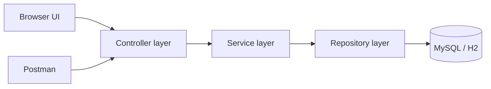

# Enterprise IT Incident Management System

Professional Spring Boot application for reporting, assigning, tracking, and resolving IT incidents.

**Developer:** Soma Manoj  
**GitHub:** [Somamanoj](https://github.com/Somamanoj)  
**Target role:** Java Developer (UST Global)

---

## 1. Project overview

This project is a small enterprise-style help desk. Employees log technical problems. IT support engineers pick up tickets, update status, add resolution comments, and close work. Admins see organisation-wide numbers and can assign engineers.

It is built as a real backend first: REST APIs, Spring Security with JWT, JPA entities, validation, and tests. A Bootstrap UI sits on top of those APIs so the flow is easy to demo in an interview.

## 2. Problem statement

In many offices, IT issues still move through chat and email. Tickets get lost, nobody owns them, and managers cannot see how many critical issues are still open.

This system gives one place to:

- raise an incident with category and priority
- assign it to a support engineer
- track status from Open to Closed
- keep a history of every important change

## 3. Features

- Employee registration and secure login
- Role-based access: Employee, Support Engineer, Admin
- Create incidents (title, description, category, priority)
- Search by incident ID; filter by priority, status, and category
- Assign incidents to engineers
- Status workflow: Open → Assigned → In Progress → Resolved → Closed
- Resolution comments and full incident history
- Dashboards with total, open, in-progress, resolved, and critical counts
- BCrypt password hashing and JWT authentication
- Global exception handling with consistent JSON errors

## 4. Technology stack

| Layer | Technology |
| --- | --- |
| Language | Java 17 |
| Backend | Spring Boot 3, Spring MVC, Spring Data JPA, Hibernate, Spring Security |
| Database | MySQL 8 (H2 in-memory profile for local demo) |
| Frontend | HTML, CSS, JavaScript, Bootstrap 5 |
| Build | Maven |
| Tests | JUnit 5, Mockito |
| API testing | Postman collection in `/postman` |

## 5. Architecture diagram



**How to explain the layers in an interview**

1. **Controller** — receives HTTP requests (`@RestController`). It validates input and returns JSON. It does not contain SQL.
2. **Service** — business rules live here: who can see a ticket, how status can change, when history is written. Methods that change data use `@Transactional`.
3. **Repository** — Spring Data JPA interfaces. Method names and `@Query` become SQL. Hibernate talks to MySQL.
4. **Entity** — Java classes mapped to tables with `@Entity`.
5. **DTO** — request/response objects. The API never returns the password field from `User`.
6. **Exception** — `@RestControllerAdvice` turns failures into a standard error JSON.
7. **Config** — security, JWT, password encoder, demo user seeding.

This is classic **Controller → Service → Repository → Database**.

## 6. Database schema

### users

| Column | Type | Notes |
| --- | --- | --- |
| id | BIGINT PK | Auto increment |
| full_name | VARCHAR(100) | Required |
| email | VARCHAR(120) | Unique |
| password | VARCHAR | BCrypt hash |
| role | VARCHAR | EMPLOYEE / SUPPORT_ENGINEER / ADMIN |
| created_at | DATETIME | Set on insert |

### incidents

| Column | Type | Notes |
| --- | --- | --- |
| id | BIGINT PK | Auto increment |
| title | VARCHAR(150) | |
| description | VARCHAR(2000) | |
| category | VARCHAR | HARDWARE, SOFTWARE, NETWORK, ACCESS, EMAIL, OTHER |
| priority | VARCHAR | LOW, MEDIUM, HIGH, CRITICAL |
| status | VARCHAR | OPEN, ASSIGNED, IN_PROGRESS, RESOLVED, CLOSED |
| reporter_id | BIGINT FK | users.id |
| assignee_id | BIGINT FK | users.id, nullable |
| created_at | DATETIME | |
| updated_at | DATETIME | |
| resolved_at | DATETIME | Set when resolved |

### incident_comments

| Column | Type | Notes |
| --- | --- | --- |
| id | BIGINT PK | |
| incident_id | BIGINT FK | incidents.id |
| author_id | BIGINT FK | users.id |
| comment | VARCHAR(2000) | |
| created_at | DATETIME | |

### incident_history

| Column | Type | Notes |
| --- | --- | --- |
| id | BIGINT PK | |
| incident_id | BIGINT FK | incidents.id |
| changed_by_id | BIGINT FK | users.id |
| action | VARCHAR | CREATED, ASSIGNED, STATUS_CHANGED, COMMENT_ADDED |
| old_value | VARCHAR | Previous status or assignee |
| new_value | VARCHAR | New status or assignee |
| details | VARCHAR | Extra note |
| created_at | DATETIME | |

Relationships:

- One user reports many incidents.
- One engineer can be assigned many incidents.
- One incident has many comments and many history rows.

## 7. API documentation

Base URL: `http://localhost:8080`

Send JWT as `Authorization: Bearer <token>` after login.

| Method | Path | Access | Success |
| --- | --- | --- | --- |
| POST | `/api/auth/register` | Public | 201 |
| POST | `/api/auth/login` | Public | 200 |
| POST | `/api/incidents` | Employee, Admin | 201 |
| GET | `/api/incidents` | Authenticated (filtered by role) | 200 |
| GET | `/api/incidents/{id}` | Owner, assigned engineer, admin | 200 |
| PUT | `/api/incidents/{id}/status` | Engineer, Admin | 200 |
| PUT | `/api/incidents/{id}/assign` | Engineer, Admin | 200 |
| POST | `/api/incidents/{id}/comments` | Engineer, Admin | 201 |
| GET | `/api/incidents/{id}/history` | Same as get by id | 200 |
| GET | `/api/dashboard/stats` | Authenticated | 200 |
| GET | `/api/engineers` | Authenticated | 200 |
| GET | `/api/admin/users` | Admin | 200 |

Query parameters for `GET /api/incidents`: `id`, `priority`, `status`, `category`.

Error body example:

```json
{
  "timestamp": "2026-11-01T12:00:00",
  "status": 400,
  "error": "Bad Request",
  "message": "Validation failed",
  "path": "/api/incidents",
  "details": ["title: Title is required"]
}
```

Import `postman/Incident-Management.postman_collection.json` to try the APIs.

## 8. Installation instructions

### Prerequisites

- Java 17
- Maven 3.9+
- MySQL 8 (only if you use the `mysql` profile)

### Run with H2 (fastest demo)

```bash
cd enterprise-it-incident-management
mvn test
mvn spring-boot:run
```

Open [http://localhost:8080](http://localhost:8080)

H2 console: [http://localhost:8080/h2-console](http://localhost:8080/h2-console)  
JDBC URL: `jdbc:h2:mem:incidentdb` · User: `sa` · Password: empty

### Demo logins

These accounts are created on first startup. Change them with environment variables before any real deployment.

| Role | Email | Default local password |
| --- | --- | --- |
| Admin | admin@company.com | `ChangeMeAdmin123!` |
| Support engineer | engineer@company.com | `ChangeMeEngineer123!` |
| Employee | employee@company.com | `ChangeMeEmployee123!` |

Employees can also register from the UI.

## 9. MySQL configuration

1. Copy `.env.example` and set your own values. Do not commit `.env`.
2. Start MySQL. The JDBC URL uses `createDatabaseIfNotExist=true`, so the schema name `incident_management` is created if missing.
3. Run:

```bash
export SPRING_PROFILES_ACTIVE=mysql
export DB_USERNAME=root
export DB_PASSWORD=your_mysql_password
export JWT_SECRET='replace-this-with-a-long-random-string-at-least-32-characters'
export ADMIN_PASSWORD='a-strong-admin-password'
export ENGINEER_PASSWORD='a-strong-engineer-password'
mvn spring-boot:run
```

Hibernate `ddl-auto=update` creates tables from entities. That is convenient for a portfolio project. Production systems normally use Flyway or Liquibase migrations instead.

## 10. Screenshots

Add images under `docs/screenshots/` after a local run:

- `login.png` — login page
- `employee-dashboard.png` — employee stats
- `create-incident.png` — report form
- `incident-details.png` — status, comments, history
- `support-dashboard.png` — engineer queue
- `admin-dashboard.png` — org-wide view

Placeholder folder: `docs/screenshots/`.

## 11. Testing instructions

```bash
mvn test
```

What the tests cover:

- Spring context starts (`IncidentManagementApplicationTests`)
- Registration creates an `EMPLOYEE` and rejects duplicate emails (`AuthServiceTest`)
- Creating an incident starts in `OPEN` and writes history (`IncidentServiceTest`)

Manual UI test:

1. Login as employee, create a Critical network incident.
2. Login as admin, assign it to the engineer.
3. Login as engineer, move status to In Progress, add a comment, resolve it.
4. Confirm history shows Created → Assigned → Status changes.

## 12. Future enhancements

- Email notifications when a ticket is assigned or resolved
- File attachments (screenshots of the error)
- SLA clocks for Critical tickets
- Flyway versioned SQL migrations
- Pagination on the incident list
- Refresh tokens and password reset

## 13. Developer information

**Soma Manoj**  
GitHub: [https://github.com/Somamanoj](https://github.com/Somamanoj)

Interview talking points are in [INTERVIEW_PREPARATION.md](INTERVIEW_PREPARATION.md), including a two-minute project pitch for UST Global.
# it-incident-reporter
